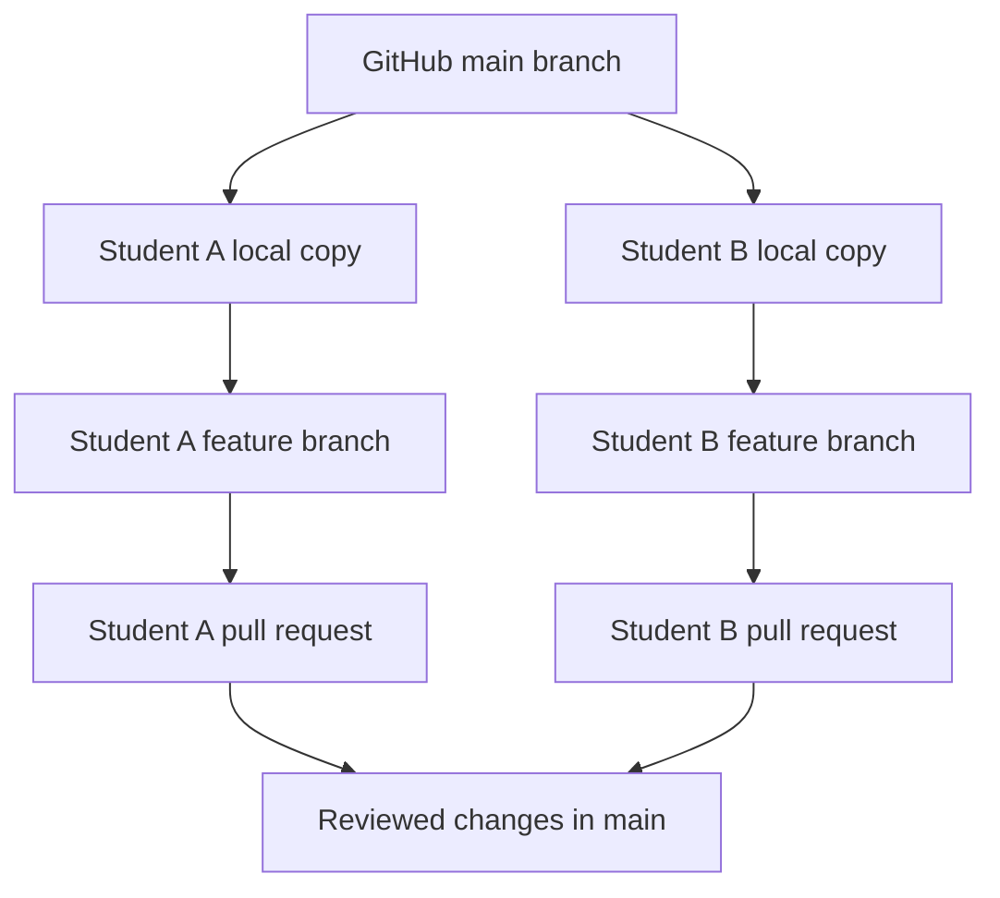

<a id="top"></a>

# Git With Friends

[Git Lessons](README.md) · [Git Simplified](GitSimplified.md)

<a id="table-of-contents"></a>
## Table of Contents

- [Introduction to Collaborative Git](#introduction)
- [Setting Up a Shared Repository](#setting-up)
- [Understanding Shared Repository Fundamentals](#fundamentals)
- [Working Together with Branches and Pull Requests](#working-together)
- [Exploring Shared Changes and History](#shared-history)
- [Merge Conflicts](#merge-conflicts)
- [Team Practice](#team-practice)
- [References](#references)

---

<a id="introduction"></a>
## Introduction to Collaborative Git

### What Is Collaborative Development?

In [Git Simplified](GitSimplified.md), you created commits, explored history, and practiced branches in your own repository. Now you will use those same skills with other students working on **one shared GitHub repository**.

Every team member has a separate copy of the repository on their own computer. Everyone can work at the same time. Git keeps track of who changed what, and GitHub provides a place to combine and review the work.

### Why Work in One Repository?

- **Shared Project:** Everyone contributes to the same program, documentation, and project files.
- **Independent Changes:** Team members can develop features without immediately changing the team's main version.
- **Review:** Teammates can inspect changes before adding them to the main project.
- **History:** Git records the changes and the commits that introduced them.

For this lesson, the team will make changes on separate branches and combine them using GitHub pull requests.

### Before You Begin

You should have completed the commits and branches sections of [Git Simplified](GitSimplified.md). Each team member needs Git installed and configured, a GitHub account, and access to a terminal. This lesson uses a repository with a default branch named `main`.

### See Also:
- [Git Basics - Branches in a Nutshell](https://git-scm.com/book/en/v2/Git-Branching-Branches-in-a-Nutshell)
- [GitHub - About Collaborative Development Models](https://docs.github.com/en/get-started/using-github/github-flow)

#### [Back To Top](#table-of-contents)

---

<a id="setting-up"></a>
## Setting Up a Shared Repository

### Create a GitHub Repository

One team member creates the repository. The other members will join as collaborators.

1. Sign in to GitHub and select **New repository**.
2. Give the repository a descriptive name, such as `TeamProject`.
3. Initialize it with a `README.md`. Choose a `.gitignore` appropriate for your programming tools.
4. Create the repository. The default branch should be `main`.
5. Open the repository's **Settings** and invite each team member as a collaborator. Each person must accept the invitation. GitHub menu labels can vary.

**Important:** For this exercise, do not have every student create a separate GitHub repository. Everyone should be working in the same shared repository.

### Clone the Repository

Every student downloads their own local copy of the shared repository using `git clone`.

Replace `OWNER` and `TeamProject` with your team's GitHub account or organization and repository name:

```sh
git clone https://github.com/OWNER/TeamProject.git
cd TeamProject
```

Check the repository:

```sh
git status
git remote -v
```

`git status` should show a clean working tree on `main`. `git remote -v` should show the team's GitHub repository as `origin`.

### See Also:
- [Git Basics - Getting a Git Repository](https://git-scm.com/book/en/v2/Git-Basics-Getting-a-Git-Repository)
- [GitHub - Inviting Collaborators to a Personal Repository](https://docs.github.com/en/repositories/managing-your-repositorys-settings-and-features/customizing-your-repository/inviting-collaborators-to-a-personal-repository)

#### [Back To Top](#table-of-contents)

---

<a id="fundamentals"></a>
## Understanding Shared Repository Fundamentals

### Key Concepts

- **Local Repository:** Your own copy of the project, including its Git history.
- **Remote Repository:** The copy of the project hosted on GitHub.
- **Origin:** The usual name Git gives the remote you cloned from.
- **Main Branch:** The team's accepted version of the project.
- **Feature Branch:** A branch where you develop a change before it becomes part of `main`.
- **Push:** Send your local commits to the remote repository.
- **Fetch:** Download remote commits and branch information without changing your working files.
- **Pull:** Fetch and then integrate changes into the current local branch.
- **Pull Request (PR):** A request on GitHub to review and merge changes from one branch into another.
- **Merge:** Combine changes from different branches.

### How the Work Fits Together



Each student has a local copy, but the team shares the same remote repository. Pushing a feature branch makes it available on GitHub; it does **not** automatically change `main`.

**Team rule:** Do not commit directly to `main` for this exercise. Use a feature branch and have a teammate review the pull request before merging. This is a team workflow rule, not a requirement enforced by Git itself.

### See Also:
- [Git Basics - Working with Remotes](https://git-scm.com/book/en/v2/Git-Basics-Working-with-Remotes)
- [GitHub - About Pull Requests](https://docs.github.com/en/pull-requests/collaborating-with-pull-requests/proposing-changes-to-your-work-with-pull-requests/about-pull-requests)

#### [Back To Top](#table-of-contents)

---

<a id="working-together"></a>
## Working Together with Branches and Pull Requests

You already practiced creating and merging local branches in [Git Simplified](GitSimplified.md#branches). The new part is sharing branches with teammates and reviewing changes before they enter `main`.

### 1. Update Your Main Branch

Before starting new work, get the latest accepted changes:

```sh
git switch main
git pull --ff-only origin main
git status
```

You should be on `main` with a clean working tree. If Git reports local changes, inspect and preserve your work before continuing.

### 2. Create Your Own Feature Branch

Create a branch for one small task:

```sh
git switch -c feature/team-notes
```

Use your own descriptive branch name. Each student should have a **different** branch, even if everyone is working in the same repository.

Check which branch is active:

```sh
git branch
```

The asterisk (`*`) indicates your current branch.

### 3. Make a Change

For this first exercise, each student creates **a different file** in the `team` directory. Replace `your-name.md` with a filename unique to you:

```sh
mkdir -p team
echo "My project responsibility: testing" > team/your-name.md
cat team/your-name.md
```

This example uses `mkdir`, `echo`, and `cat` in a shell such as Git Bash or a Linux/macOS terminal. You can also create and edit the file using your text editor.

### 4. Check, Stage, and Commit

Use the same process you practiced in the earlier lesson:

```sh
git status
git add team/your-name.md
git diff --staged
git commit -m "Document my project responsibility"
```

For a new untracked file, `git diff` will not show its contents until it is staged. Use `cat` to check the file before staging, and `git diff --staged` to review exactly what will be committed.

### 5. Push Your Branch to GitHub

Send the new branch and its commits to the shared repository:

```sh
git push -u origin feature/team-notes
```

Replace `feature/team-notes` with your actual branch name. The `-u` option sets the upstream branch so future pushes can use `git push`.

**Check:** Open the team repository on GitHub. You should see your new branch, but your file should not yet appear on `main`.

### 6. Open a Pull Request

On GitHub:

1. Select **Compare & pull request** for your branch, or open the **Pull requests** tab and select **New pull request**.
2. Set **base** to `main` and **compare** to your feature branch.
3. Enter a descriptive title and a short explanation of the change.
4. Include how you checked the work. For code changes, report the build or test result.
5. Create the pull request and request a teammate's review.

A pull request lets the team examine the change without merging it immediately.

### 7. Review a Teammate's Pull Request

Open a teammate's pull request and inspect **Files changed**. Check that the change makes sense, the intended files are included, and the requirements are met.

You can leave a comment, request a correction, or approve the work. If someone requests a change to your PR, make another commit **on the same feature branch** and push it. The PR updates automatically.

### 8. Merge the Pull Request

After the review and any required checks are complete, merge the PR into `main` on GitHub. For the exercise, use **Create a merge commit** if that option is available.

Delete the feature branch on GitHub after merging. The commit and PR history remain available.

**Check:** Switch to `main` on GitHub and verify that the new file appears. Every team member should complete this workflow at least once.

### See Also:
- [GitHub - Creating a Pull Request](https://docs.github.com/en/pull-requests/collaborating-with-pull-requests/proposing-changes-to-your-work-with-pull-requests/creating-a-pull-request)
- [GitHub - Reviewing Proposed Changes](https://docs.github.com/en/pull-requests/collaborating-with-pull-requests/reviewing-changes-in-pull-requests/about-pull-request-reviews)

#### [Back To Top](#table-of-contents)

---

<a id="shared-history"></a>
## Exploring Shared Changes and History

### Get Changes Made by Other Team Members

When a teammate merges a PR, your local copy does not update by itself. Update it with:

```sh
git status
git switch main
git pull --ff-only origin main
```

Make sure any uncommitted work is safely preserved before switching branches.

List the recent commits:

```sh
git log --oneline -5
```

Open the `team` directory and check that your teammates' files are present.

### Update a Feature Branch When Main Changes

Your team may merge other PRs while you are still working on your feature branch. First commit your current work. Then download the latest branch history and merge the remote `main` into your branch:

```sh
git switch feature/team-notes
git status
git fetch origin
git merge origin/main
```

Use your actual branch name. If the merge succeeds, build or verify the resulting project. If Git reports a conflict, use the next section.

### View the Shared History

To see the different branches and how they were combined:

```sh
git log --oneline --graph --decorate --all -12
```

You should recognize some of your own commits and commits made by your teammates.

### See Also:
- [Git Basics - Viewing the Commit History](https://git-scm.com/book/en/v2/Git-Basics-Viewing-the-Commit-History)
- [Git Basics - Working with Remotes](https://git-scm.com/book/en/v2/Git-Basics-Working-with-Remotes)

#### [Back To Top](#table-of-contents)

---

<a id="merge-conflicts"></a>
## Merge Conflicts

### What Is a Merge Conflict?

A merge conflict happens when Git cannot automatically combine changes from two branches. For example, two students might both edit the same line of a file in different ways.

Git shows the conflicting versions and asks you to decide what the final content should be. That might mean keeping one change or combining both changes.

### Practice: Create a Conflict on Purpose

Work in pairs in your team's shared repository. Use `README.md` for this exercise.

#### 1. Prepare the Starting File

Before either student creates a practice branch, one student adds this line to `README.md` through a pull request and merges it into `main`:

```text
Project status: planning.
```

Both students update their local `main`:

```sh
git switch main
git pull --ff-only origin main
```

#### 2. Create Two Different Branches

Student A creates `feature/status-building`. Student B creates `feature/status-testing`. Each student starts from the same version of `main`.

Student A changes the line to:

```text
Project status: building.
```

Student B changes the original line to:

```text
Project status: testing.
```

Each student commits their own change and pushes their branch to GitHub.

#### 3. Merge Student A's Work First

Student A opens a PR, gets it reviewed, and merges it into `main`. Student B leaves their PR unmerged and does not update the feature branch yet.

Now `main` contains `building`, but Student B's feature branch still contains `testing`.

#### 4. Merge Main into Student B's Branch

Student B runs:

```sh
git switch feature/status-testing
git status
git fetch origin
git merge origin/main
```

Git should report a conflict in `README.md`.

#### 5. Inspect and Resolve the Conflict

Open `README.md`. The conflicting lines will resemble:

```text
<<<<<<< HEAD
Project status: testing.
=======
Project status: building.
>>>>>>> origin/main
```

The lines between `<<<<<<< HEAD` and `=======` are from the current branch. The lines after `=======` are from the changes being merged.

Work together to decide on a suitable final line, such as:

```text
Project status: building and testing.
```

Delete the conflict markers and the original conflicting lines. Leave only the final version and save the file.

#### 6. Complete the Merge

Student B checks the result, stages the resolved file, commits, and pushes:

```sh
git diff
git status
git add README.md
git commit -m "Resolve project status conflict"
git push
```

The open PR updates with the conflict resolution. After review, merge Student B's PR. Both students update their local `main` and verify that the final line is correct.

### What If Something Goes Wrong?

Inspect the repository state before choosing a recovery command:

```sh
git status
git diff
git log --oneline --graph --decorate --all -10
```

If you are in the middle of an unfinished merge and need to abandon that attempt, `git merge --abort` will usually restore the state from before the merge started. Avoid `reset --hard` and force-push commands unless you understand their effect on shared work.

A successful automatic merge does not prove that the combined program works. Changes in different files can still be incompatible. Build and test after integrating code.

### See Also:
- [Git - Basic Merge Conflicts](https://git-scm.com/book/en/v2/Git-Branching-Basic-Branching-and-Merging)
- [GitHub - Resolving a Merge Conflict](https://docs.github.com/en/pull-requests/resolving-merge-conflicts-after-a-git-pull)

#### [Back To Top](#table-of-contents)

---

<a id="team-practice"></a>
## Team Practice

### Apply the Workflow to Your Group Project

Repeat the branch, commit, push, review, and merge process using a real part of your group project. Agree on the task before beginning. Keep changes small enough that someone else can understand and review them.

For each new task:

1. Update `main` and create a new feature branch.
2. Make one coherent change and verify it.
3. Review the diff, commit, and push.
4. Open a pull request and have a teammate review it.
5. Merge the accepted change and update everyone's local `main`.

### Check Your Team's Work

- [ ] Everyone cloned the **same** shared GitHub repository.
- [ ] Everyone created and pushed their **own** branch.
- [ ] Everyone opened at least one pull request.
- [ ] Everyone reviewed at least one teammate's pull request.
- [ ] The team created and resolved a merge conflict.
- [ ] The accepted changes are present on `main` and the integrated project builds or otherwise works as intended.

Keep links to your commits, pull requests, and reviews. They show your contributions to the shared project. Your project assignment may have additional requirements for documenting your work.

### Common Problems

| Problem | What to Check | What to Do |
| --- | --- | --- |
| GitHub will not let you push | `git remote -v` and your GitHub collaborator invitation | Confirm that you accepted the invitation and are pushing to the correct repository and branch. |
| You are working on `main` | `git branch` and `git status` | Create or switch to a feature branch before making more changes. |
| Git refuses to switch branches | `git status` | Commit or otherwise preserve uncommitted changes before switching. |
| `git push` is rejected | `git status`, `git branch -vv`, and `git fetch` | Find out which remote commits are missing. Do not immediately force-push. |
| A merge reports conflicts | `git status` and the files listed as unmerged | Resolve the intended content, stage it, complete the merge, and test. |
| A teammate's merged file is missing locally | `git branch` and `git status` | Switch to `main` and run `git pull --ff-only origin main`. |

### See Also:
- [Git Simplified](GitSimplified.md)
- [Git Documentation](https://git-scm.com/docs)

#### [Back To Top](#table-of-contents)

---

<a id="references"></a>
## References

- **Official Git Documentation:** [Git Documentation](https://git-scm.com/doc)
- **Official Pro Git Book:** [Git Book](https://git-scm.com/book/en/v2)
- **GitHub Pull Requests:** [GitHub Pull Request Documentation](https://docs.github.com/en/pull-requests)
- **GitHub Collaboration:** [GitHub Flow](https://docs.github.com/en/get-started/using-github/github-flow)
- **Earlier Lesson:** [Git Simplified](GitSimplified.md)

#### [Back To Top](#table-of-contents)
